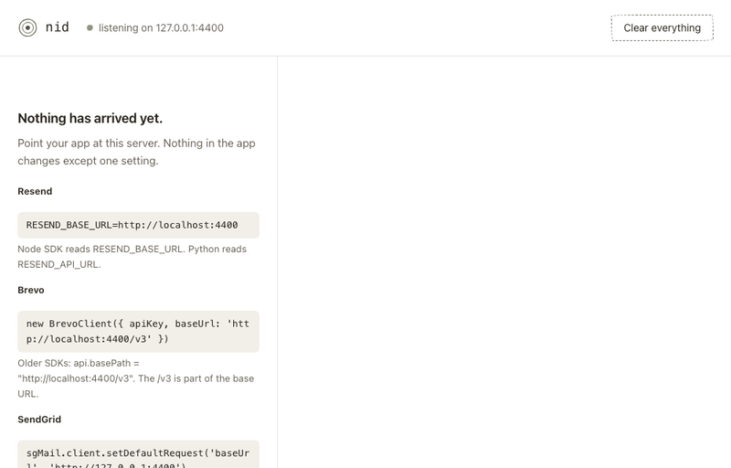

# nid

Local email API, inbox, and webhook simulator for testing apps and AI agents.

While you build or run tests, your app sends email to nid instead of real recipients. nid intercepts official email SDKs with zero app-code changes, validates requests with provider-shaped errors, triggers signed webhooks back to your app, and wakes waiting tests and AI agents when mail arrives. No email leaves your machine. nid calls out only to the webhook URLs you set.



**[Read the documentation](https://github.com/oluwatobiadegoke/nid/blob/main/docs/README.md)**, or start with the [ten-minute tutorial](https://github.com/oluwatobiadegoke/nid/blob/main/docs/tutorials/get-started.md).

## Quick start

You need Node.js 22.13 or later.

1. Run your app with nid:

   ```sh
   npx nid-inbox run -- npm run dev
   ```

   `nid run` starts nid in the background and redirects outbound HTTP calls for the Resend, Amazon SES, Brevo, SendGrid, Postmark, and Mailgun SDKs without changing your app code.

2. Open [http://127.0.0.1:4400](http://127.0.0.1:4400) in your browser to see arrived messages, HTML previews, sign-in codes, links, refused requests, and webhook deliveries.

If your app runs outside `nid run` (such as Docker or another language), start nid on its own and point your email SDK or SMTP client at it:

```sh
npx nid-inbox serve
```

SMTP listens on `127.0.0.1:1025`, and HTTP provider APIs and the read API listen on `http://127.0.0.1:4400`.

## Read mail in tests

Your tests can wait on mail with zero polling. In Playwright:

```ts
import { test, expect } from '@nid-inbox/client/playwright'

test('sign up, then resend the code', async ({ page, inbox }) => {
  const email = inbox.address('signup')
  await page.fill('#email', email)
  await page.click('text=Send code')
  const first = await inbox.waitFor(email, { hasCode: true })
  await page.click('text=Resend code')
  const second = await inbox.waitFor(email, { hasCode: true })
  expect(second.code).not.toBe(first.code)
  await page.fill('#code', second.code!)
})
```

## What sets nid apart

- **Zero-code provider APIs and SDK error fidelity**: Answers the HTTP APIs for Resend, Amazon SES (v2 JSON and v1 XML), Brevo, SendGrid, Postmark, and Mailgun, plus SMTP on port 1025. Redirects official Node SDKs via `nid run` or `nid-inbox/intercept` and returns provider-shaped 4xx validation errors.
- **Event-driven test helpers and rejection diagnostics**: `@nid-inbox/client` and `/api/wait` wake over an internal event bus when mail arrives, with Playwright fixtures and automatic code and link extraction. When a wait times out, nid reports matching refused sends so failures explain why email never arrived.
- **Signed webhook simulation and fault injection**: Triggers provider-signed webhooks (`delivered`, `bounced`, `deferred`, `complained`, `opened`, `clicked`), supports `--auto-webhook` after acceptance, and simulates rate limits, bounces, deferrals, complaints, and custom HTTP errors via magic addresses (`ratelimit@`, `bounce@`, `defer@`, `complain@`) or `/api/faults`.
- **Built-in MCP server for AI agents**: Exposes `new_address`, `wait_for_email`, `get_code`, `get_links`, `get_message`, `list_messages`, `list_rejections`, `trigger_webhook`, and `clear` over HTTP (`/mcp`) and stdio (`nid mcp`).

## Packages

| Package | What it is |
| --- | --- |
| [`nid-inbox`](https://www.npmjs.com/package/nid-inbox) | The server, `nid run` / `nid serve` CLI, and `nid-inbox/intercept` preload hook. |
| [`@nid-inbox/client`](https://www.npmjs.com/package/@nid-inbox/client) | Typed test client and Playwright fixture. |
| [`ghcr.io/oluwatobiadegoke/nid`](https://github.com/users/oluwatobiadegoke/packages/container/package/nid) | The Docker image. |

## Documentation

| Kind | Pages |
| --- | --- |
| Tutorial | [Get started](https://github.com/oluwatobiadegoke/nid/blob/main/docs/tutorials/get-started.md) |
| How-to guides | [See your mail in the web view](https://github.com/oluwatobiadegoke/nid/blob/main/docs/how-to/use-the-web-view.md), [Run nid](https://github.com/oluwatobiadegoke/nid/blob/main/docs/how-to/run-nid.md) (npm, Docker, Playwright, GitHub Actions), [Point your app at nid](https://github.com/oluwatobiadegoke/nid/blob/main/docs/how-to/connect-your-app.md), [Read mail in tests](https://github.com/oluwatobiadegoke/nid/blob/main/docs/how-to/read-mail-in-tests.md), [Test your webhook handler](https://github.com/oluwatobiadegoke/nid/blob/main/docs/how-to/test-webhooks.md), [Use the command line](https://github.com/oluwatobiadegoke/nid/blob/main/docs/how-to/use-the-cli.md), [Let an AI agent read your mail](https://github.com/oluwatobiadegoke/nid/blob/main/docs/how-to/connect-an-ai-agent.md), [Embed nid in your own code](https://github.com/oluwatobiadegoke/nid/blob/main/docs/how-to/embed-nid.md) |
| Reference | [Command line](https://github.com/oluwatobiadegoke/nid/blob/main/docs/reference/cli.md), [Configuration](https://github.com/oluwatobiadegoke/nid/blob/main/docs/reference/configuration.md), [Read API](https://github.com/oluwatobiadegoke/nid/blob/main/docs/reference/read-api.md), [Client library](https://github.com/oluwatobiadegoke/nid/blob/main/docs/reference/client.md), [Providers](https://github.com/oluwatobiadegoke/nid/blob/main/docs/reference/providers.md), [MCP reference](https://github.com/oluwatobiadegoke/nid/blob/main/docs/reference/mcp.md) |
| Explanation | [How nid works](https://github.com/oluwatobiadegoke/nid/blob/main/docs/explanation/how-nid-works.md), [Security](https://github.com/oluwatobiadegoke/nid/blob/main/docs/explanation/security.md) |

## Contributing

Each provider is one file under `packages/server/src/providers/`, and docs change in the same pull request as the code. See [CONTRIBUTING.md](https://github.com/oluwatobiadegoke/nid/blob/main/CONTRIBUTING.md).

## License

Apache-2.0.
